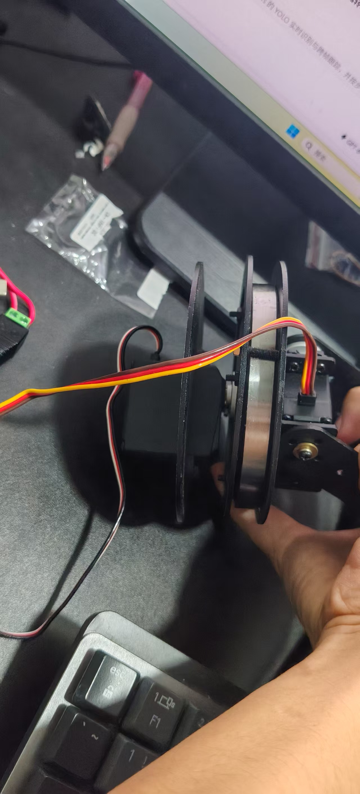
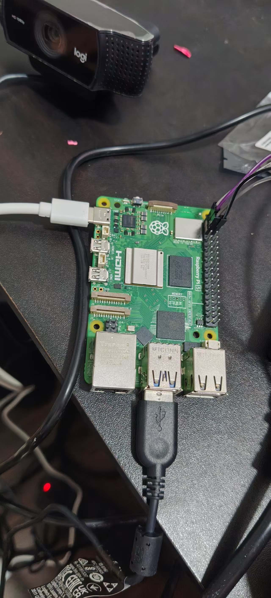
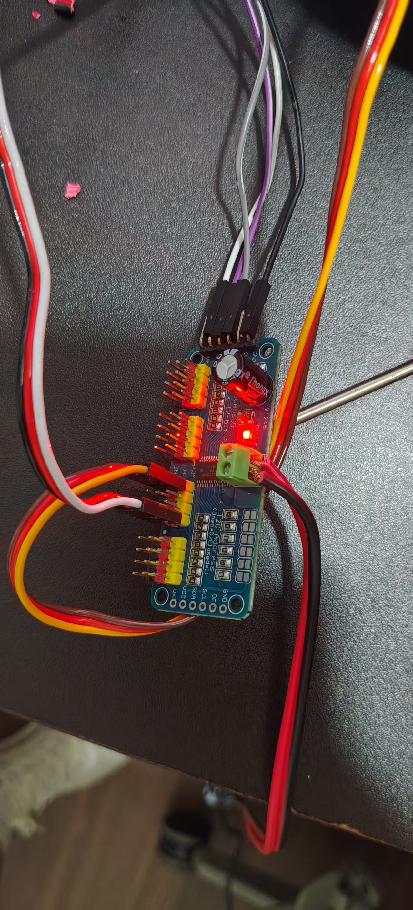

# 项目进展

以下是原型实物及联调照片。照片记录当时的装配状态；接线和固定方式仍会随测试调整。

## 双轴云台

云台由上下两个 MG996R 舵机驱动：上方舵机控制俯仰，下方舵机控制水平转动。C922 已固定到俯仰支架，USB 线留有运动余量。

## 树莓派与摄像头

C922 接在树莓派 5 的 USB 接口。树莓派负责采集画面，通过 Wi-Fi 和 SSH 转发给 Windows 主机；目标检测及跟踪在主机运行。实时取流已用 30 帧验证，这不是性能或准确率测试。

## 舵机控制板

PCA9685 通过 I²C 与树莓派通信，舵机由独立 5 V 电源供电。上方俯仰舵机接 8 通道，下方水平舵机接 11 通道。两台舵机均在短时脉宽测试中动作；8 通道脉宽由 1450 增至 1550 微秒时，支架向上；11 通道相同变化时，从镜头后方观察云台向左。

目前只验证了单轴动作。两组水平轴测试画面中的固定背景未出现可测的位移，摄像头与云台的实际联动还需排查。因此还不能把视觉偏差接入舵机并称为闭环跟踪。下一步是确认摄像头随两个轴稳定运动，校准中位、方向和安全行程，再进行自动跟随测试。
